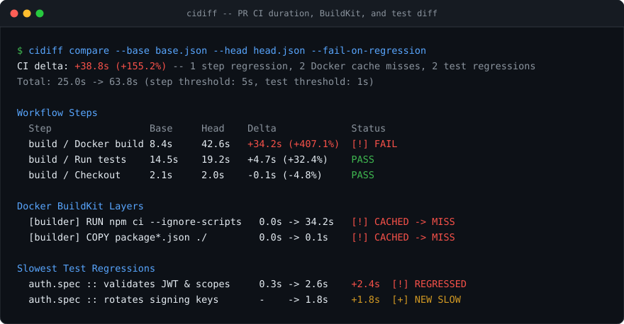

<h1 align="center">cidiff</h1>

<p align="center">
  <strong>Zero-SaaS GitHub Action and CLI that explains why a pull request slowed CI down.</strong><br>
  Node 20+ &middot; zero runtime dependencies &middot; correlates workflow steps, Docker BuildKit cache misses, and per-test timings
</p>

<p align="center">
  <a href="https://github.com/Hinikaa/cidiff/actions/workflows/ci.yml"></a>
  
  
  <a href="LICENSE"></a>
</p>

<p align="center">
  
</p>

---

## Why

Total workflow timers tell you CI got slower, not why. `cidiff` compares a PR run against `main` across three signals at once: GitHub Actions job/step durations, Docker BuildKit `--progress=plain` layer cache flips (`CACHED -> MISS`), and test durations (`JUnit XML`, `go test -json`, `Vitest`/`Jest` JSON). It updates a single `<!-- cidiff -->` PR comment and optionally writes a self-contained HTML diff report.

## Install and Usage

### CLI

```sh
npm install -g cidiff
```

Or run from a built checkout:

```sh
npm install && npm run build
node dist/cli.js record --out base.json --junit test-results.xml --buildkit buildkit.log
node dist/cli.js compare --base base.json --head head.json --format markdown --fail-on-regression
```

Run the included fixture demo locally:

```sh
npm run demo
```

### GitHub Action

```yaml
- name: Run tests
  run: npx vitest run --reporter=json --outputFile=vitest.json

- name: Compare CI performance
  uses: Hinikaa/cidiff@v1
  with:
    vitest-paths: vitest.json
    buildkit-log: buildkit.log
    step-threshold-sec: "5"
    test-threshold-sec: "1"
    html-report-path: cidiff-report.html
```

## CLI Reference

### `cidiff record`

| Flag | Description | Default |
| --- | --- | --- |
| `--out <path>` | Output snapshot JSON path (required) | - |
| `--junit <path...>` | JUnit XML file path(s) | - |
| `--gotest <path...>` | `go test -json` NDJSON file path(s) | - |
| `--vitest <path...>` | Vitest or Jest JSON report file path(s) | - |
| `--buildkit <path>` | `docker buildx build --progress=plain` log path | - |
| `--steps <json-or-path>` | Step timings JSON array or path to JSON file | - |
| `--commit <sha>` | Commit SHA metadata | - |
| `--branch <name>` | Branch name metadata | - |

### `cidiff compare`

| Flag | Description | Default |
| --- | --- | --- |
| `--base <path>` | Base snapshot JSON path (required) | - |
| `--head <path>` | Head snapshot JSON path (required) | - |
| `--format <fmt>` | Output format: `markdown`, `json`, or `html` | `markdown` |
| `--html-out <path>` | Write self-contained HTML report to path | - |
| `--step-threshold <sec>` | Step regression threshold in seconds | `5` |
| `--test-threshold <sec>` | Test regression threshold in seconds | `1` |
| `--fail-on-regression` | Exit with code `1` when regressions are found | `false` |

Exit codes: `0` ok, `1` regression threshold exceeded with `--fail-on-regression`, `2` error.

## GitHub Action Inputs and Outputs

### Inputs

| Input | Description | Default |
| --- | --- | --- |
| `baseline-file` | Path to base snapshot JSON; falls back to GitHub API base branch run | - |
| `junit-paths` | Comma or newline separated JUnit XML paths | - |
| `gotest-paths` | Comma or newline separated `go test -json` paths | - |
| `vitest-paths` | Comma or newline separated Vitest/Jest JSON paths | - |
| `buildkit-log` | Path to BuildKit `--progress=plain` log | - |
| `github-token` | Token for workflow step lookup and PR comment upsert | `${{ github.token }}` |
| `comment` | Post or update PR comment (`true`/`false`) | `true` |
| `step-threshold-sec` | Step regression threshold in seconds | `5` |
| `test-threshold-sec` | Test regression threshold in seconds | `1` |
| `fail-on-regression` | Fail step when regressions are detected (`true`/`false`) | `false` |
| `html-report-path` | Optional path to write self-contained HTML report | - |

### Outputs

| Output | Description |
| --- | --- |
| `total-delta-sec` | Total duration delta in seconds |
| `regression-count` | Count of step regressions, Docker cache misses, and test regressions |
| `report-markdown` | Rendered Markdown summary |

## Extending Parsers

Register custom test report formats with `registerTestParser` from [src/parsers/index.ts](src/parsers/index.ts):

```ts
import { registerTestParser, parseTestFile } from "cidiff";

registerTestParser("custom", (content) => {
  return JSON.parse(content).map((row: { suite: string; name: string; sec: number }) => ({
    suite: row.suite,
    name: row.name,
    durationSec: row.sec,
    status: "pass",
  }));
});

const tests = parseTestFile("custom", rawContent);
```

## License

[MIT](LICENSE)
